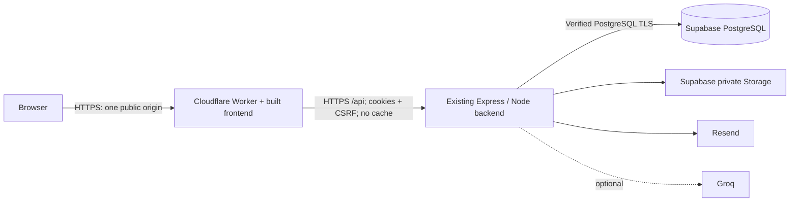

# Deployment plan and runbook

This setup preserves the existing application. The intended deployment is Cloudflare Workers for the frontend, Render’s free Node/container hosting for Express, Supabase PostgreSQL and private Storage, and Resend. Render is the selected backend target through `render.yaml`; the Dockerfile is portable. The prototype will use Cloudflare’s provided `workers.dev` address, so no purchased domain is needed.

No provider resources have been created by adding these files. A local Git repository has been initialized for this deployment. CI and Render repository integration still require publishing the source to your own private remote repository. Keep `.env`, `.local`, and production data out of that repository.

## Architecture decisions

| Requested component | Existing implementation and deployment decision |
| --- | --- |
| React / Vite / Router / Tailwind | Keep React, Vite, the current navigation and CSS. Do not add Router or Tailwind just for deployment. |
| Cloudflare Workers frontend | Add a static-assets Worker with a same-origin `/api` proxy. |
| Capacitor / Android | Deferred: packaging, native permissions, deep links and session handling require separate work and device testing. |
| Supabase Auth | Keep backend cookie sessions, existing user IDs and role permissions. Supabase Auth is a separate migration. |
| Edge Functions / PostgREST | Keep Express and direct PostgreSQL transactions. Do not expose tables via PostgREST. |
| PostgreSQL / RLS | Use Supabase PostgreSQL. Existing facility/role/clinical access remains enforced by Express. Per-user RLS is not implemented. |
| Supabase Storage | Use the existing private-bucket adapter; only the backend has the service-role key. |
| Realtime | Keep the current five-second polling and stale warnings. |
| Gemini / Resend / FCM / OSRM | Configure existing Resend; retain optional Groq and local approved-information fallback. Gemini, push and mapping are separate feature work. |



## 1. Accounts and domains

Create/select a dedicated production Supabase project, a Cloudflare account, a free Render backend service, and a Resend account with a verified sending domain. Select suitable regions and plans in those accounts; importing `render.yaml` selects the free plan in Singapore, as requested for the prototype. Choose one canonical public HTTPS origin, either a Cloudflare custom domain or the Worker's `workers.dev` URL. Set backend `APP_URL` to exactly that origin.

Provision a separate staging project and backend for deployment rehearsals. Never point CI/integration tests or local `setup` at production. No app keys belong in Cloudflare frontend assets or `VITE_*` variables.

For this domain-free prototype, Resend’s `onboarding@resend.dev` sender can be used for delivery tests to the email address associated with the Resend account. Other patient addresses cannot receive normal booking/reset emails until you verify a domain you control. Cloudflare’s shared `workers.dev` address cannot serve as your verified sending domain. Use fictional test accounts and do not claim general email delivery is ready. See [Resend’s test-domain restriction](https://resend.com/docs/knowledge-base/403-error-resend-dev-domain).

## 2. Supabase PostgreSQL and Storage

Before migrating, **disable the Data API** in the Supabase project's Data API settings. The app has no Supabase client authentication or RLS policies. Its `public` tables must not be reachable through anonymous/authenticated PostgREST requests. Keep the Data API disabled for this deployment. Do not add tables to Realtime publications. Disabling the Data API does not replace the existing backend's authorization and does not prevent its direct PostgreSQL connections.

Copy the actual PostgreSQL connection string from Supabase's Connect dialog. Use the direct endpoint when your backend supports its network requirements, otherwise the **session pooler on port 5432** for IPv4. URL-encode password characters. Use `sslmode=verify-full`; if a provider CA is required, supply `sslrootcert=/absolute/path/to/provider-ca.crt` in the URL and mount that certificate on the backend/provisioning host. Do not disable certificate verification. Enable SSL enforcement and restrict database network access to the hosting/provisioning egress addresses where available.

Create the `quecare-private` Storage bucket with **Public bucket off**. No anonymous read/write policies are needed: authorized uploads/downloads pass through Express using the server-only service-role key. The app accepts single uploads up to 5 MB; keep bucket restrictions compatible with the app's PDF/JPEG/PNG upload types. Keep the service-role key out of the frontend and Worker.

Use the project database owner for the initial migration/bootstrap commands. This preserves existing migration behavior; it is not a per-user RLS deployment. A separately restricted runtime database role can be provisioned by your database operator after validating all required table permissions. Do not enable RLS against a non-bypass runtime role without compatible policies: it would break the app.

## 3. Backend configuration and initial provisioning

Use `.env.production.example` as the inventory for backend secret settings. Leave your development `.env` unchanged. Required: `NODE_ENV=production`, `ALLOW_DEMO_LOGIN=false`, canonical `APP_URL`, verified-TLS `DATABASE_URL`, Supabase storage values, `EMAIL_PROVIDER=resend`, a real `RESEND_API_KEY`, and verified `EMAIL_FROM`. Groq remains optional.

Build and run the backend container on a host with HTTPS:

```sh
docker build -t quecare-api:release .
# With a private, completed .env.production file:
docker run --rm --env-file .env.production quecare-api:release npm run db:migrate
```

For Render, connect your repository, import `render.yaml`, and supply the prompted environment values. Free services do not include shell access or one-off jobs, so run migrations and initial provisioning from the private local/container environment described here. Automatic deployment is disabled to keep migrations deliberate. Run `npm run db:migrate` once through a private provisioning machine/container with the production database credentials before directing users to the service. Do not use the local setup or demo seed commands.

Provision the first administrator once, using temporary secrets supplied privately to the provisioning process:

```sh
# INITIAL_ADMIN_NAME, INITIAL_ADMIN_EMAIL, INITIAL_ADMIN_PASSWORD must be set
# privately in this process (or an ignored provisioning env file).
npm run db:bootstrap
```

Remove the provisioning secrets immediately afterward. The script refuses to create a second system administrator. It provisions the seven RHUs without demo patients; configure staff, queues and approved directory content through the app.

Validate the completed backend environment (never prints secret values):

```sh
# dotenv reads .env normally; explicitly choose the private production file:
DOTENV_CONFIG_PATH=.env.production npm run check:deployment
# Alternatively run npm run check:deployment in the host's configured environment.
```

This is a configuration check, not provider connectivity proof. Set the host's readiness/health path to `/api/health`; it checks PostgreSQL. `npm start` is the container default. For a local container rehearsal:

```sh
docker run --rm --env-file .env.production -p 3001:3001 quecare-api:release
```

No persistent disk is required when Supabase Storage and Resend are configured. The image retains the existing `tsx` runtime and locked dependencies because `npm start`, migrations, and bootstrap execute TypeScript. It also retains `dist` so the current same-host frontend serving remains available at the backend origin.

## 4. Cloudflare frontend and gateway

The gateway serves `dist` and sends only `/api` and `/api/*` to the backend. It preserves Origin, session cookies, CSRF headers, request bodies and response cookies. All API responses get `Cache-Control: no-store`. Upstream redirects are not followed with user credentials. Static pages receive CSP and the core security headers previously supplied by Express.

```sh
npm ci
npm run build
npm run check:cloudflare
npx wrangler login
# Enter only the HTTPS backend origin, for example https://quecare-api.onrender.com
npx wrangler secret put API_ORIGIN
npm run deploy:cloudflare
```

`API_ORIGIN` must be the backend origin without a path, credentials or query, and must differ from the public Worker origin. It is a Worker runtime setting, never a frontend build variable. The dry run needs no provider credentials. Cloudflare's native login prompts handle account access; do not paste tokens in chat or commit them. API fetches and the public smoke check allow 90 seconds for the free backend to wake. Render free services sleep after 15 minutes without incoming traffic and typically take about a minute to restart. The first request may be slow or fail if startup exceeds that allowance; refresh after startup. The gateway does not automatically retry mutations. See [Render free-instance behavior](https://render.com/docs/free). An always-on plan remains appropriate for routine operations.

For a custom domain, add the Worker custom domain in Cloudflare and set `APP_URL` on the backend to that exact origin. For `workers.dev`, use the URL returned by deployment. Login, reset links and QR links must all resolve to the same chosen public origin. Alternate frontend origins will be rejected for mutations by the existing Origin check. No CORS relaxation or cross-site cookies are required.

Local preview disables automatic loading of the backend `.env`; only use the separate `.dev.vars` for Worker settings. For local gateway preview, copy `.dev.vars.example` to ignored `.dev.vars`, fill the HTTPS staging backend origin, then run `npm run preview:cloudflare`. That preview does not bypass production Origin checks; use a staging backend configured for the preview origin when testing mutations. Preview still connects to whichever backend you configure; use fictional staging data.

The Express backend currently trusts one proxy hop. Verify the host's actual forwarding behavior before release: two independent client networks must not collapse onto one rate-limit identity, and a client-supplied `X-Forwarded-For` must not control that identity. The gateway replaces that header with Cloudflare's client IP, but the backend host can add another hop. If the host's topology does not fit the current setting, use a compatible ingress configuration or make a separately reviewed backend proxy-trust change.

## 5. Verification and release

Local verification:

```sh
npm run build
npm test
npm run test:integration
npm run check:cloudflare
# Local DB and installed Chrome required for the existing production browser check:
npm run verify:production
```

The GitHub workflow builds, runs domain/gateway tests and isolated PostgreSQL integration tests, bundles the Worker without publishing, and builds the backend image. It has no production secrets and does not migrate or deploy production.

After publishing, run the read-only smoke check:

```sh
npm run verify:deployment -- https://your-public-origin
```

Then rehearse on staging: patient registration and login/logout, staff permissions and facility boundaries, queue registration/check-in/call/transfer, booking contention, record consent/revocation, private attachment upload/download, password reset through actual Resend email, QR links, and polling. Verify anonymous Supabase REST access is unavailable and the bucket is private. Confirm a known valid account is rate-limited correctly without unrelated clients sharing its bucket. Existing frontend/authorization behavior has not been rewritten.

## 6. Backups, rollback and operations

Enable provider-managed database backups with retention and recovery targets chosen by the operator. Back up Storage objects separately: database backups include object metadata, not the object bytes. Rehearse restoring database and attachments into a separate project, verify attachment ownership/downloads, then record the recovery time before using real records.

Keep release commit IDs, container image identifiers and Cloudflare deployment versions. Roll back the frontend using Cloudflare's prior deployment and the API using the host's previous image/release. Current SQL migrations are additive/versioned; do not automatically reverse migrations or restore a database over active patient writes. Future incompatible migrations require a tested, coordinated rollback plan.

Monitor public `/api/health`, backend errors, email delivery failures, Storage failures and database capacity. Avoid logging cookies, credentials, reset/tracking tokens or clinical data. Confirm production consent text, service information, retention and institutional access procedures with the operator before handling actual patient records.

## Source documentation

- [Cloudflare static assets and bindings](https://developers.cloudflare.com/workers/static-assets/binding/)
- [Cloudflare SPA routing](https://developers.cloudflare.com/workers/static-assets/routing/single-page-application/)
- [Supabase database connections and TLS](https://supabase.com/docs/guides/database/connecting-to-postgres)
- [Supabase API security](https://supabase.com/docs/guides/api/securing-your-api)
- [Supabase secure data guidance](https://supabase.com/docs/guides/database/secure-data)
- [Render Docker hosting](https://render.com/docs/docker)
- [Render Blueprint specification](https://render.com/docs/blueprint-spec)

## Preparation verification (13 November 2026, Manila)

Passed locally: production frontend/TypeScript build; eight domain/gateway tests; all 19 PostgreSQL integration tests; the existing production browser smoke check; Worker type check and dry-run bundle; local Workers runtime serving the real frontend with CSP and returning uncached JSON for unconfigured API requests; production-configuration rejection/acceptance checks without secret output. Production dependency audit reported zero vulnerabilities.

Docker is not installed on the preparation machine, so the container build remains unverified locally; the CI workflow includes it. Live database, private Storage, Resend delivery, public gateway/backend integration, proxy/rate-limit behavior and backup recovery remain release checks requiring provider accounts. No live deployment URL has been provisioned by this preparation.
